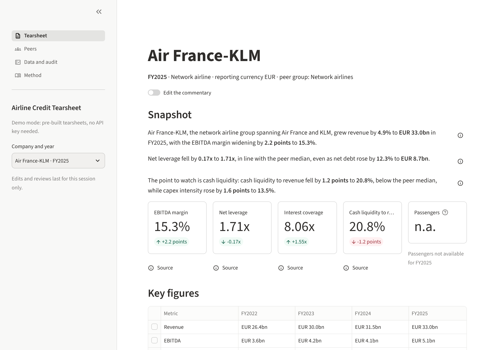
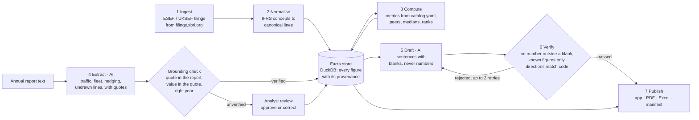

# Airline Credit Tearsheet

[](https://github.com/imi79/airlines-analyzer/actions)

**A two-page credit tearsheet for European airlines and airports, built from their annual
regulatory filings, where every figure is traced to its source and checked before it reaches
the page.**

**Live demo: [airlines-analyzer.streamlit.app](https://airlines-analyzer.streamlit.app)** · no login, no key ·
sample PDFs: [Air France-KLM](samples/pdf/afkl_FY2025.pdf),
[easyJet](samples/pdf/easyjet_FY2025.pdf), [Aena](samples/pdf/aena_FY2025.pdf)



## What it does

Pick an issuer and a fiscal year. The tool reads the company's ESEF or UKSEF annual filing,
computes the credit metrics, reads what the filing does not tag from the report text, drafts the
commentary, and produces:

- a **web app** where any figure opens its source: the tagged filing fact, the formula and its
  inputs, or the sentence quoted from the annual report;
- a **two-page PDF** for the reader and an **Excel backup** where every ratio is a live formula
  (`=net_debt_FY2025/ebitda_FY2025`) that recalculates to the app's value;
- a **run manifest**: every filing behind the figures with its SHA-256 fingerprint, and the AI
  models and prompt versions that touched the tearsheet.

The analyst view is never drafted: the analyst writes it.

## Why it is built this way

AI-drafted credit notes are routine; the problem is trusting the numbers. Here the division of
labour is strict:

| | Generic AI drafting | This tool |
| --- | --- | --- |
| Figures | Written by the model, checked by the reader | Computed by code from the filing; the model can only *reference* them |
| Commentary | Free text | Sentences with labelled blanks (`{{net_leverage@FY2025}}`) that code fills in |
| Checking | Optional | A verifier reads every sentence; anything unchecked never reaches the page |
| Sector logic | Generic corporate template | Lease-adjusted leverage, advance ticket sales, ASK, RASK, CASK, revenue per passenger |
| Data | Paid feeds | Free regulatory filings (filings.xbrl.org) |

## How it works

Seven stages around one facts store. Stages 4 and 5 use an AI model; nothing they produce
reaches the store or the page without a check in code.



1. **Ingest.** The annual filing as structured data (xBRL-JSON), cached on disk; packages the
   database lacks are converted with Arelle; two FY2025 statements entered by hand from the PDF.
2. **Normalise.** Standard IFRS concepts mapped to canonical statement lines, with per-company
   overrides; values stored as reported, with their decimals.
3. **Compute.** Every metric defined once in [`catalog.yaml`](src/tearsheet/metrics/catalog.yaml)
   and applied identically to every issuer; peers compared on aligned fiscal years.
4. **Extract (AI).** What the filing doesn't tag (passengers, ASK, fleet, fuel hedging, undrawn
   facilities, airport segments) is read from the report text with the exact quote. Code checks
   the quote is in the report, the value is in the quote and the year matches.
5. **Draft (AI).** The model fills a form: sentences with blanks, plus the direction it claims for
   each figure. Directions (up, down, better, worse) are computed by code.
6. **Verify.** Code rejects any number written outside a blank, any unknown or unverified figure,
   any direction word that contradicts the computed change. Rejected sections go back to the
   model with the errors, twice at most.
7. **Publish.** The web app, the PDF (WeasyPrint) and the Excel backup (XlsxWriter) are built
   from the same facts.

**Any AI provider.** All model calls go through one layer; Anthropic, DeepSeek or any
OpenAI-compatible gateway is a line in [`config/models.yaml`](config/models.yaml). Every answer
is recorded, so a rebuild replays it at no cost and the audit trail travels with the repository.

## Results

Each milestone closed against a written checklist ([progress](docs/progress.md)); the misses are
stated as plainly as the passes.

| Check | Result |
| --- | --- |
| Figures loaded vs the published statements (two issuers, two years) | 68 of 68 match |
| Metrics vs a second-source model (gate 1: leverage within 0.05x, ratios within 0.1 point) | 62 of 62 within tolerance |
| Figures read from report text: none wrong marked verified | 0 wrong of 93 labelled |
| Figures read from report text: at least 80% verified automatically | **Missed**: 78% on the blind set, 59% on a later set; the rest go to analyst review |
| Verifier against deliberately faulty sentences | 47 of 47 rejected, each for the right rule |
| Ten consecutive drafts with no number outside a blank (gate 2) | 11 in a row across all nine issuers |
| Commentary quality, scored 1 to 5 against the annual reports (target 4) | **3.78**: accurate and safe, short of the target on insight |
| Every figure on screen traced to a filing fact, a quote or a hand entry | 1,986 of 1,986 |
| PDF on two A4 pages, no overflow | 18 of 18 |
| Excel recalculated (LibreOffice) equals the app | 2,044 of 2,044 values, 195 of 195 medians |

**After v1, M8: cash flow after leases, refinancing, ratings**
([decision 0022](docs/decisions/0022-m8-cash-flow-refinancing.md)).

| Check | Result |
| --- | --- |
| FCF after leases and debt due within a year vs a second-source model (Air France-KLM, ADP, FY2024-FY2025) | 16 of 16 within tolerance |
| Maturity wall read from the debt note: none wrong marked verified (answer key of 11 tables, eight company-years) | 0 wrong; 4 verified, the rest flagged for review |
| Verifier against faulty sentences, with typed ratings and maturities added | 52 of 52 rejected |
| Two sections redrafted: notes in a row with no number outside a blank | 14 in a row (target 10) |
| PDF on two pages / Excel recalculated, with the new figures | 18 of 18 / 18 of 18 |

The design choices are recorded as short notes in [`docs/decisions/`](docs/decisions/), and each
milestone has a plain-language walkthrough (for example [M5, the web app](docs/m5/walkthrough.md)).

## Coverage

Nine issuers, FY2021 onward, compared within their peer group:

| Network airlines | Low-cost airlines | Airports |
| --- | --- | --- |
| Air France-KLM, International Airlines Group, Finnair | easyJet (Sep year end), Norwegian, Wizz Air (Mar year end) | Groupe ADP, Aena, Flughafen Wien |

Lufthansa, Ryanair and Fraport are not on filings.xbrl.org (German and Irish filings are
missing), so they are out of v1.

## Run it

Python 3.12 and [uv](https://docs.astral.sh/uv/).

```bash
uv sync
uv run tearsheet app
```

The app opens in demo mode from the pre-built tearsheets in [`samples/`](samples/): no key, no
database, no network. To rebuild everything from the filings (downloads them once):

```bash
uv run tearsheet all
```

Other commands: `uv run tearsheet export` (PDF, Excel and manifest for every tearsheet),
`uv run tearsheet draft` (asks the AI for drafts not yet recorded; needs the key named in
`config/models.yaml`). With Docker:

```bash
docker build -t airline-credit-tearsheet .
docker run -p 8501:8501 airline-credit-tearsheet
```

Tests: `uv run pytest` (no network; recorded fixtures).

## Repository

```text
src/tearsheet/
  ingest/      filings.xbrl.org client, cache, Arelle for hand-loaded packages
  normalize/   IFRS concept map and per-issuer overrides
  store/       DuckDB schema
  metrics/     catalog.yaml (definitions and spreadsheet formulas), formulas, peers
  llm/         provider-neutral AI client with recorded answers
  extract/     section locator, AI extraction, grounding checks
  narrative/   fact sheet, drafting prompts, verifier
  render/      figure library and source cards, PDF, Excel, manifest
  app/         Streamlit pages
config/        issuers, peers, models, reviews
samples/       pre-built tearsheets for the demo, sample PDFs
records/llm/   every AI answer, by request fingerprint
docs/          spec, decisions, milestone results and walkthroughs
tests/         unit tests, golden files, the verifier's adversarial suite
```

## Limits

- Annual figures only; no half-year or last-twelve-months figures.
- The tool's own metric definitions, applied identically: they differ from company-reported
  and rating-agency-adjusted figures (no pension or hybrid adjustments).
- The drafted commentary is a starting point for the analyst (3.78 of 5), not a finished note.
- Some operating figures await analyst review and show as "pending" until then.
- The debt maturity wall is checked and shown for 4 of 18 tearsheets; the others show the
  debt due within a year from the balance sheet, and their tables wait for analyst review.
- Ratings are shown as stated in each company's own report (reviewed by the analyst); three
  reports give none.
- The free hosting puts the demo to sleep after 12 hours without visitors; the first visitor
  waits about half a minute.

## Licence and disclaimer

[MIT](LICENSE). Data from public regulatory filings. Draft prepared with AI assistance; figures
computed from regulatory filings and checked automatically. Not investment advice.
