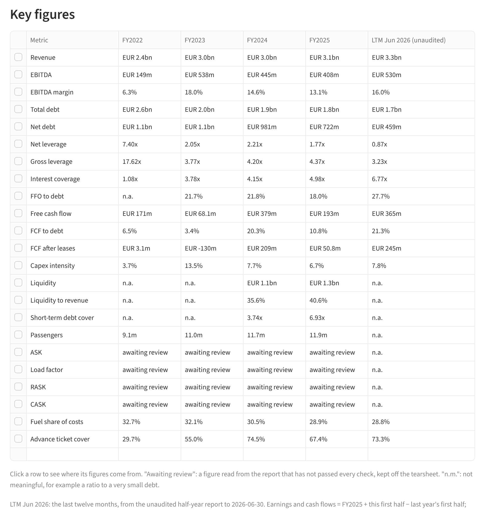
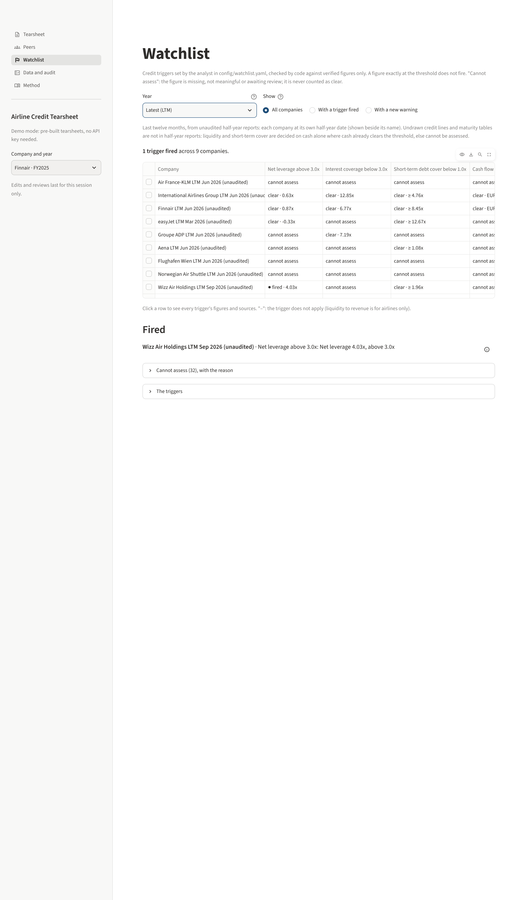

# M10 walkthrough: half-year and last-twelve-months figures

**What M10 built.** Until now the tool knew each company once a year, so in November the
freshest leverage was eleven months old. M10 reads each company's latest half-year report and
adds, beside the fiscal years, **where the name stands on the last twelve months (LTM)**: the
way you would test a covenant on trailing earnings, not on a first half doubled (airlines earn
their money in the summer, so a doubled first half would badly misstate the year).

- Earnings and cash flows at LTM = last full year + this first half − last year's first half.
  Finnair: revenue 3,106.2 + 1,694.8 − 1,481.9 = 3,319.1.
- Debt and cash at LTM = the half-year balance sheet. So LTM net leverage = net debt at
  30 June ÷ EBITDA of the last twelve months.

Every annual figure, tearsheet and PDF is exactly as before (checked byte for byte). The
commentary is not redrafted and the PDF does not change.

## What you will see

| Where | What is new |
| --- | --- |
| **Tearsheet**, key figures table | An extra column after the latest fiscal year: **"LTM Jun 2026 (unaudited)"** (easyJet: LTM Mar 2026; Wizz Air: LTM Sep 2026). A note under the table says how it is built. Click a row: the LTM figure opens on its three parts, each down to its page |
| **Watchlist**, year picker | A new choice, **"Latest (LTM)"**: every company at its own half-year date, your seven triggers, moves measured against the last fiscal year |
| **Data and audit** | A new section, "Half-year report": every line read, the control it passed, or why it waits for you |
| **Method** | Two lines on LTM, and that half-year figures are unaudited |

## How a half-year figure is checked (in credit terms)

Think of the AI as a junior who is only allowed to **point at a line** of the statements. It
never types a number. The code then reads the number off the page itself and runs three
tests, like a second pair of eyes on a spreading sheet:

1. **The opening balance sheet must tie.** Every half-year balance sheet reprints 31 December.
   That column must equal our database, line by line. If it does not, the column or the unit
   is wrong and nothing on that statement is trusted. Result: it tied for all nine companies.
2. **The row must be the right row.** Where the report prints the full year beside the half
   (Finnair, Norwegian), that full-year number must equal our database. Where it does not,
   the row's label must be the one under which last year's annual report printed our figure.
3. **The statements must add up**: assets = equity + liabilities; opening cash + movements =
   closing cash.

A figure that fails any test is **"awaiting review"** and stays off the page, exactly as for
the annual figures.

**The answer key** (58 lines for Finnair, IAG and ADP, written by me from the PDFs and saved
*before* the AI ran): 56 verified and correct, **0 verified but wrong**, 2 sent to you. One of
the two was a real mistake that the test caught (below).

## Results by company

| Company | Half year to | Lines read | Confirmed | Waiting for you | LTM net leverage |
| --- | --- | ---: | ---: | ---: | --- |
| IAG | 30 Jun 2026 | 19 | 19 | 0 | 0.63x (FY2025: 0.78x) |
| Finnair | 30 Jun 2026 | 21 | 21 | 0 | 0.87x (FY2025: 1.77x) |
| Wizz Air | 30 Sep 2026 | 21 | 18 | 3 | **4.03x** (FY2026: 3.79x), fires your 3.0x trigger |
| Groupe ADP | 30 Jun 2026 | 18 | 16 | 2 | missing: the items of ADP's own net debt definition are not in a half-year balance sheet |
| Aena | 30 Jun 2026 | 19 | 16 | 3 | 1.73x, awaiting review (net debt 6,724m, as Aena itself reported) |
| easyJet | 31 Mar 2026 | 22 | 16 | 6 | −0.33x, net cash (FY2025: −0.42x) |
| Norwegian | 30 Jun 2026 | 16 | 14 | 2 | 0.78x, awaiting review |
| Air France-KLM | 30 Jun 2026 | 20 | 11 | 9 | missing (as for ADP), and income lines wait for you |
| Flughafen Wien | 30 Jun 2026 | 17 | 0 | 17 | entered by hand, waiting for your check |

Nine of nine loaded (the pass mark was seven).

## Two findings worth a credit analyst's attention

**1. At 30 June, airlines are at their cash peak.** Summer tickets are paid in advance, so the
half-year balance sheet carries a lot of customers' money: Norwegian's advance ticket sales
went from NOK 4.4bn at year end to 8.6bn, and its net debt from 9.5bn to 5.3bn. LTM leverage
then sets twelve months of earnings against a seasonally flattering balance sheet: think of a
borrower tested the day after collecting its customers' deposits. easyJet's half year ends in
March, the other end of the cycle. Read the LTM column with that in mind; a June-against-June
comparison is a natural next step.

**2. Air France-KLM changed its income statement in 2026** (new standard IFRS 18) and restated
its first half of 2025. Its "operating profit" is now defined differently from the FY2025
figure in our database. LTM = FY2025 (old definition) + H1 2026 − H1 2025 (new definition)
would mix the two, so these lines wait for you rather than going on the page.

## What I need from you

**1. Check Flughafen Wien's 17 hand entries** (`config/half_year_entries.yaml`, against pages
28, 30 and 31 of its report). Its PDF shows the figures but does not hold them as text, so I
typed them from the page images. Their 31 December column already equals our database on all
five balance sheet lines. If they are right, put your name and the date in `reviewed_by`.

**2. Look at the lines waiting for review.** Each has its reason on the Data and audit page.
My suggestion for each:

| Company, line | What the tool saw | My suggestion |
| --- | --- | --- |
| ADP, capex | The AI took purchases (548) alone; our annual capex also counts the change in payables on asset purchases | **Correct** to 646 and 540 (548 + 98, 478 + 62, page 39), the same definition as the annual 1,218 |
| ADP, lease payments | 12 and 16, the right row (page 39); the label test did not find the annual row | **Approve** |
| Norwegian, D&A | The AI took "Aircraft lease, depreciation and amortisation" (full year 4,155); our figure is the cash flow row (4,231) | **Correct** to 2,333 and 1,931 (page 15, whose full-year column is 4,231) |
| Norwegian, capex | The condensed cash flow prints one net row "Purchases, proceeds and prepayment" (4,880), not gross capex (4,986) | **Leave it waiting**: there is no correct figure in the half-year report |
| Air France-KLM, 9 income and cash flow lines | New income statement format (finding 2) | **Leave waiting** for now; M11 can rebase on the restated FY2025 in its note 4 |
| easyJet, 6 lines (finance costs, interest, cash from operations, capex, lease payments, interest paid) | Half-year labels differ from the annual ones; the values match pages 20 and 24 as I read them | Approve after a look at pages 20 and 24 |
| Aena, D&A, capex, disposals | Labels differ from the annual report; D&A includes a 0.2m impairment row | Approve after a look at pages 8 and 12 |
| Wizz Air, profit, share of associates, interest paid | Labels differ from the annual report | Approve after a look at pages 11 and 15 |

To approve or correct, add a few lines to `config/half_year_reviews.yaml` (an example is at the
top of the file) with your reason, or tell me what you decided and I will write them.

**3. Read the LTM column and the watchlist at "Latest (LTM)"**, and tell me if a number
surprises you.

**4. Say go to merge into `main`.** The public link follows `main`; after the merge I open it
myself in a fresh browser and check every page before telling you it is live.

## For the record

- AI tokens: about 60,000 for reading the eight reports (planned 200,000 to 400,000). No
  drafting tokens. No new software.
- Tests: 804 pass (80 new: reading rows and columns, the controls, the LTM arithmetic, the
  pages). Every one of the 335 LTM figures traces down to a filing fact, a report row or a
  hand entry. PDF still two pages for all 18 tearsheets, Excel recalculated 18 of 18.
- Files: `docs/m10/coverage.md` (the coverage check), `docs/m10/half_year.md` (every line, its
  control or its reason, and the LTM metrics, per company), `docs/m10/answer_key_score.md`,
  decision 0025.
