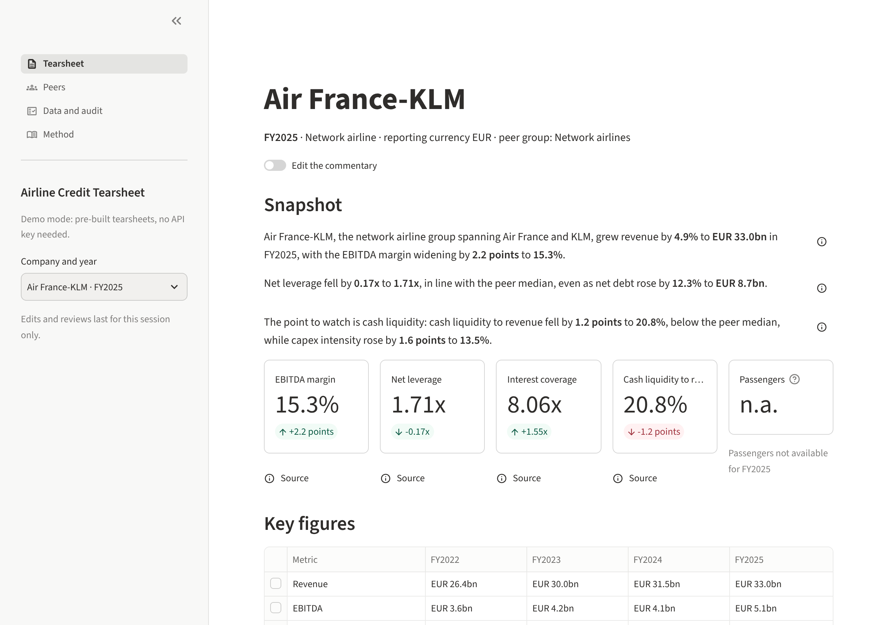
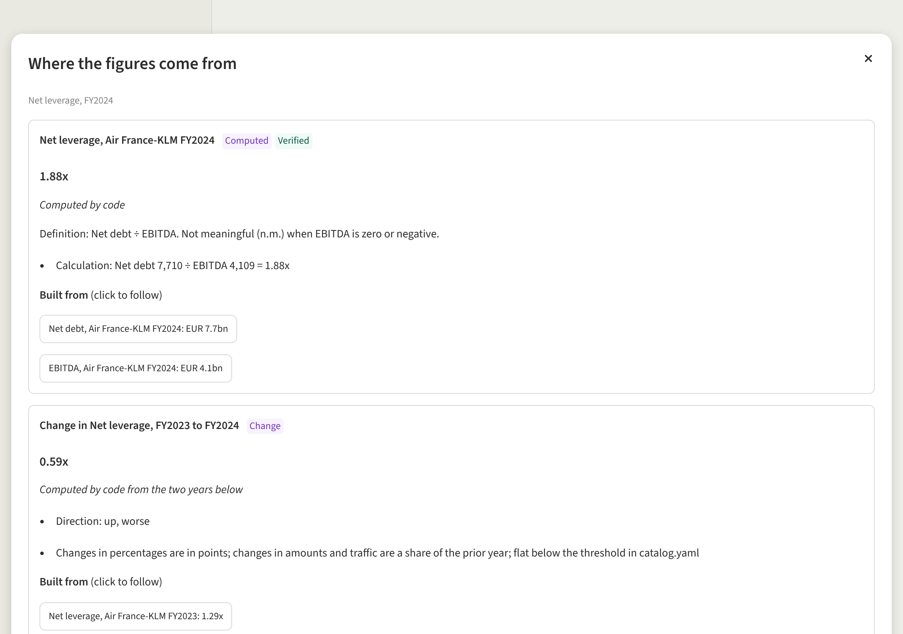
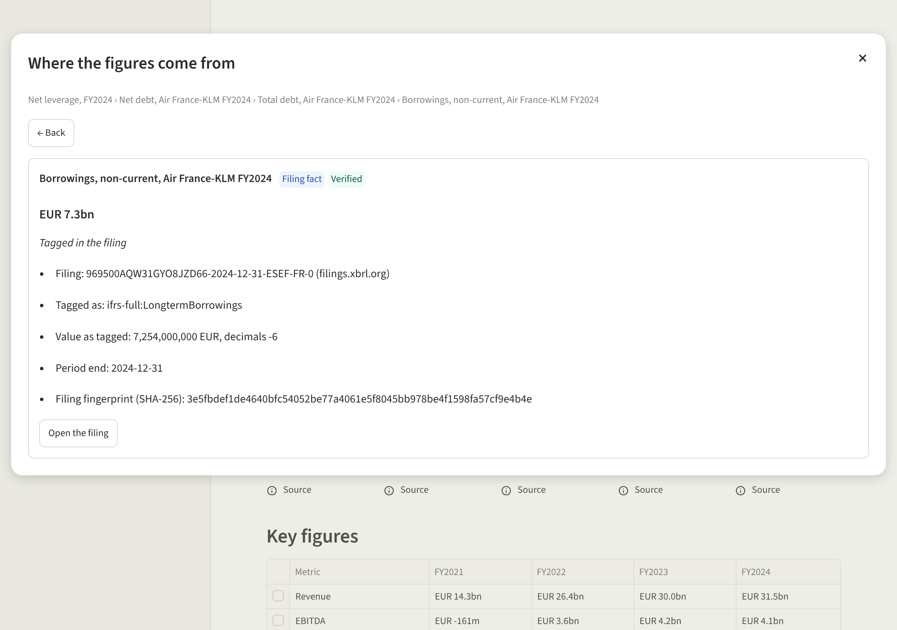
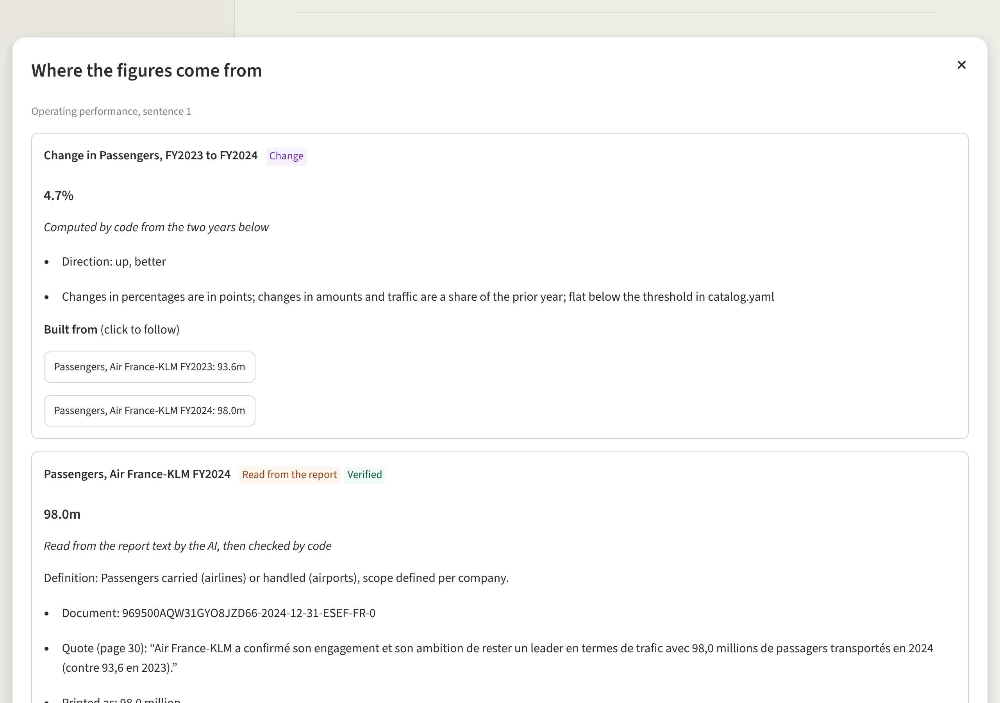
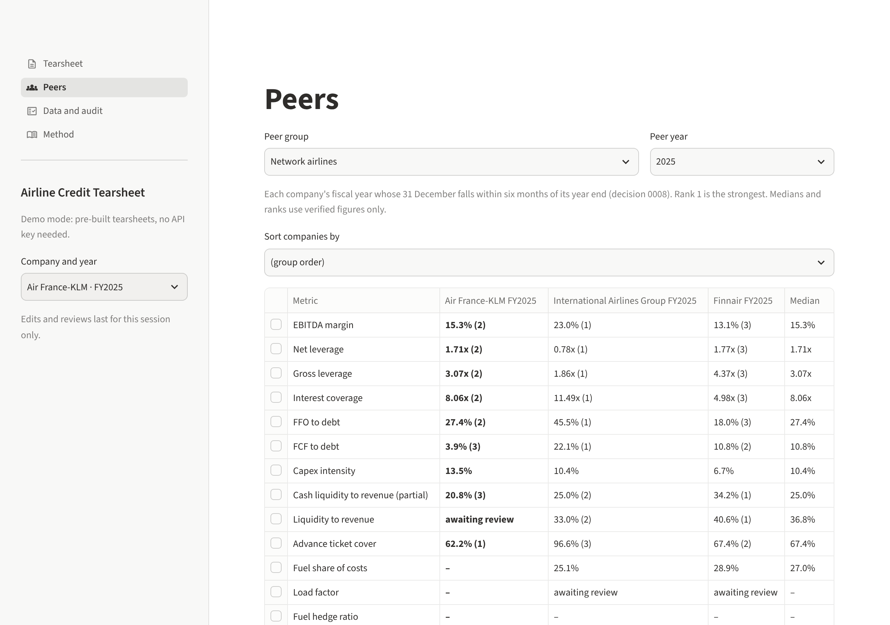
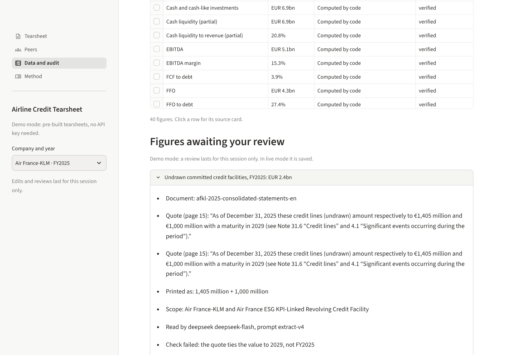

# M5 walkthrough: the tearsheet on screen, with the working papers one click away

**What M5 builds.** The web app. Pick a company and a year, read the tearsheet, click any
figure to see where it came from, edit the commentary, write your own view, and approve or
correct the figures waiting for your review. Four pages: **Tearsheet**, **Peers**, **Data and
audit**, **Method**. Think of a client deliverable whose working papers sit one click behind
every number.

## Open it

On your machine, or in a cloud session, from the repository folder:

```bash
uv run tearsheet app
```

It opens in the browser at `http://localhost:8501`. A link can name the tearsheet:
`http://localhost:8501/?company=wizz&year=2026`.

**Two modes** (decision 0019):

- **Demo** (the default, and the only mode on the public link in M7): the 18 pre-built
  tearsheets in `samples/`. No API key, no database, no internet. Your edits and reviews last
  for your browser session only: a visitor cannot change the public tearsheet.
- **Live** (appears in the sidebar only where the database has been built with
  `uv run tearsheet all`): the figures straight from the database, any year. Edits and
  reviews are saved.

## A tour in five clicks

1. **The tearsheet.** Header with the fiscal year and its months, the snapshot, the KPI cards
   with the move on last year, the four-year table, the leverage and liquidity charts, the
   rest of the commentary, and an empty analyst view at the bottom.
   
2. **Click "Source" under net leverage.** The card shows the formula and the figures it was
   built from, each clickable.
   
3. **Follow it down**: net debt, then total debt, then borrowings. You reach the filing fact:
   the IFRS tag, the value exactly as tagged, the filing's fingerprint and a button to open
   the filing in the official viewer. The trail at the top shows the path; "Back" returns.
   
4. **Click the (i) at the end of a commentary sentence.** Every figure of the sentence opens:
   for a passenger figure, the sentence it was read from in the annual report, with the page.
   
5. **Peers and Data and audit.** The Peers page has the group table with medians and ranks
   (click a row for each company's source and the median's), and the leverage against margin
   scatter. Data and audit lists every figure of the year, the figures awaiting your review,
   the filings with their links, and the record of the AI draft.
   
   

## What you can do

- **Edit the commentary.** Switch on "Edit the commentary", change a sentence, press "Save
  this section". Figures you leave as printed stay linked to their source. A figure you type
  yourself has no source: the sentence is marked "contains a figure not traced to a source"
  (your choice in the plan: warn, don't refuse). Edited sentences show "edited by the
  analyst". Saved in live mode to `notes/<company>_FY<year>.yaml`.
- **Write the analyst view.** The box at the bottom; never drafted by the AI.
- **Approve or correct a figure.** Data and audit, "Figures awaiting your review": the quote,
  the page and why the checks failed; choose approve or correct, give a reason. A reason is
  required, and a percentage is entered as a fraction (0.856 for 85.6%), as in the reviews
  file. In live mode it is written to `config/extraction_reviews.yaml` with your name and the
  date; then "Rebuild the figures" applies it (under two minutes, no AI).
- **Redraft with the AI** (live mode). On Data and audit. If the company's figures haven't
  changed, the recorded drafts are replayed for free; otherwise the AI is asked, with the
  provider of `config/models.yaml`. The key comes from the environment, or you type it for
  the session: kept in memory, never written to a file.

## Results

| M5 checklist | Result | |
| --- | --- | --- |
| A pre-generated tearsheet opens in under ten seconds | 18 of 18, slowest 2.0 seconds, each in a fresh browser tab (`docs/m5/timing.md`) | ✓ |
| Every figure on screen shows its source on click | A test follows every figure the pages show, for all 18 tearsheets and every peer table, down to a filing fact, a quote or a hand entry: all 1,986 figures trace; screenshots 2 to 4 show the clicks | ✓ |
| Demo mode works without a key | Tests open every page and all 18 tearsheets with no key, no database and the network blocked | ✓ |

- **Nothing to fix in the data.** All 1,986 stored figures trace down to an original
  source: 829 filing facts, 230 figures read from the reports (each with its quote), 47 hand
  entries, and 880 figures computed from them. Every one of the 18 drafts matches today's
  figures (same fact sheet fingerprint).
- **Every peer median in the commentary matches the one the card shows.**
- **Two drafts still carry a flagged snapshot** (Finnair FY2024 and Wizz Air FY2025), as in
  M4: the page shows them with "failed the verifier after two retries: edit it before use".
  That is the place for your edit.
- **53 figures read from the reports are awaiting your review** across the nine companies
  (for example Air France-KLM's undrawn credit lines, where the quote names 2029, the
  maturity, rather than the year), and 51 ratios built on them wait with them. On the
  tearsheet they show as "awaiting review", never as a number.
- **One new display rule**: ratios to a very small debt (Vienna) show as "n.m.", as the M4
  commentary already treated them (decision 0019).
- **AI cost of M5: zero.** The live-mode redraft test replayed recorded answers.
- **Tests:** 480 in all, 99 new (source tracing, demo mode, edits, reviews, the typed key).

## Where things are

- The app: `src/tearsheet/app/` (`main.py` and one file per page in `views/`).
- The figure library, source cards, tearsheet layout, notes and reviews:
  `src/tearsheet/render/` (shared with the PDF and Excel exports in M6).
- What the app shows (KPI cards, table rows, charts): `config/app.yaml`, metric ids only.
- The demo files: `samples/`, rebuilt by `uv run tearsheet samples` after `tearsheet all`.
- Decision 0019 records the choices.

**Known limits.**

- In the commentary, the sources button is per sentence, not per number (your choice 1).
- On the free hosting a sleeping app takes about half a minute to wake; checked in M7.
- In demo mode a correction changes the figure but not the ratios built on it (live mode
  recomputes them).
