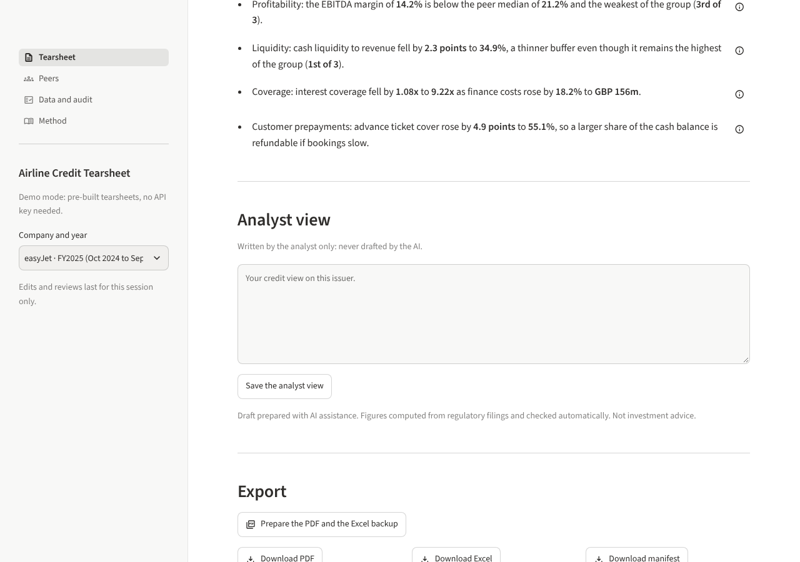
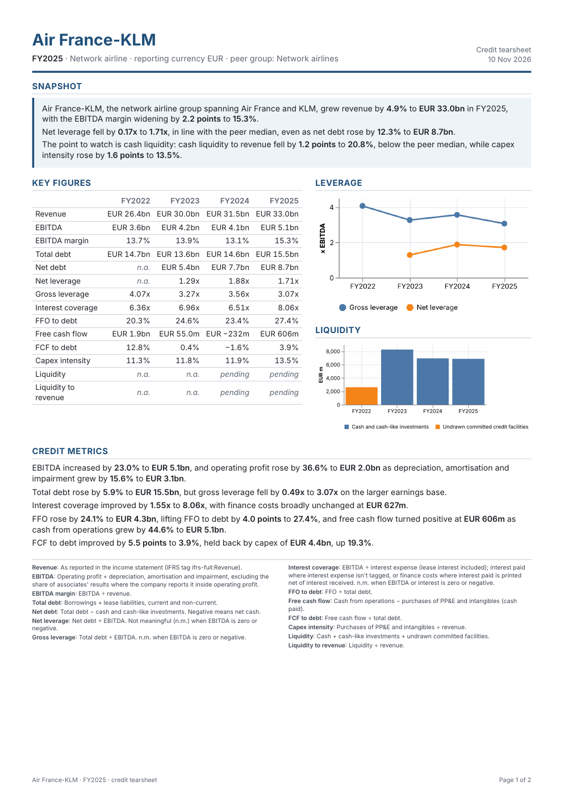
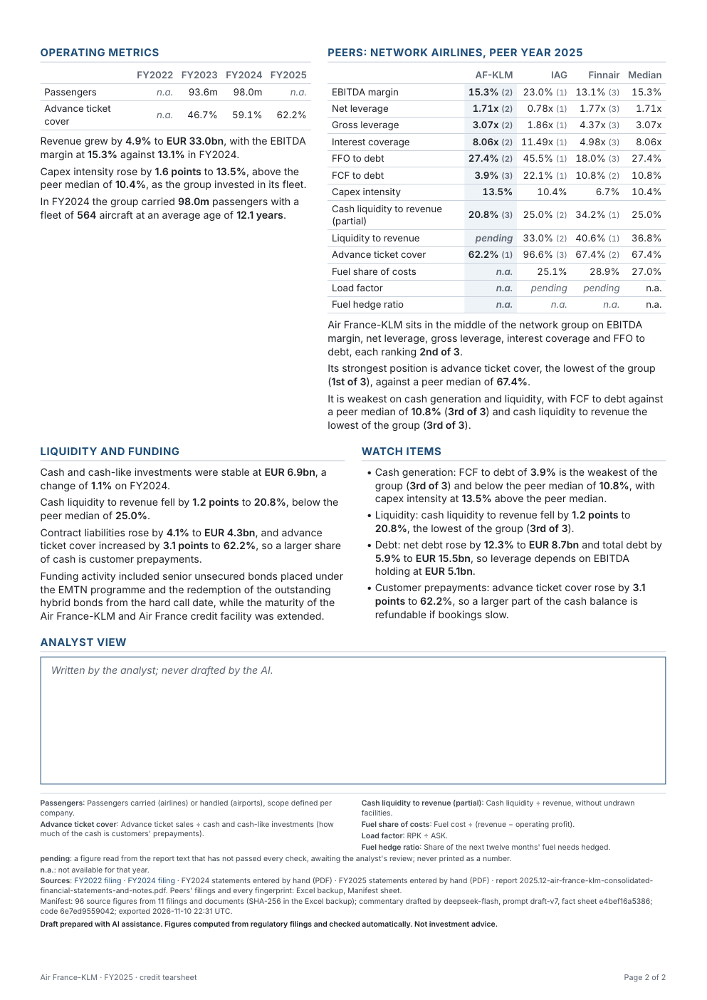

# M6 walkthrough: the credit note, its model and its cover sheet

**What M6 builds.** Three outputs for each tearsheet, from the same figures the app shows:

- the **two-page PDF**, the note a reader receives;
- the **Excel backup**, where every ratio is a live formula a reviewer can follow and redo;
- the **run manifest**, the audit stamp: which filings (with fingerprints), which AI models and
  which instruction versions produced it.

## Get them

In the app, at the bottom of the Tearsheet page: **Prepare the PDF and the Excel backup**, then
**Download PDF**, **Download Excel**, **Download manifest** (about five seconds). Your edits and
analyst view are included as they are at that moment. In demo mode nothing is saved on the
server.



From the command line, all 18 at once into `exports/`, or one:

```bash
uv run tearsheet export
```

```bash
uv run tearsheet export --issuer afkl --year 2025
```

Add `--check` to have LibreOffice recalculate every workbook and compare it with the app.

## The PDF

Page 1: header, snapshot, key figures (four years), leverage and liquidity charts, credit
metrics, and the definitions of the key figures. Page 2: operating metrics and their
commentary, the peer table and peer positioning, liquidity and funding, watch items, your
analyst view (a fixed box of eight lines), then the remaining definitions, the filings, a
one-line manifest and the disclaimer.




Reading conventions, each explained in the footnotes when used:

- **pending**: a figure read from a report that hasn't passed every check, awaiting your review.
  Never printed as a number.
- **n.m.**: not meaningful (a ratio to a very small debt, leverage on negative EBITDA).
- **n.a.**: not available for that year.
- **†**: a sentence you edited with a figure you typed, not traced to a filing.
- **‡**: a section the verifier didn't clear after two retries; edit it before sending. Today
  that is the snapshot of Finnair FY2024 and Wizz Air FY2025.

All 18 are in `docs/m6/pdf/` for you to flip through.

## The Excel backup

Five sheets: **Inputs** (every figure from the filings, the reports and your hand entries, all
years, with its source), **Metrics** (every metric and year as a live formula, next to the app's
value and the difference), **Peers** (median and rank as formulas), **Extracted** (figures read
from the reports, with their quotes and checks), **Manifest**.

Every cell is named after the figure, so formulas read like the definitions:
`=net_debt_FY2025/ebitda_FY2025`, `=operating_profit_FY2025-share_of_associates_FY2025+dda_FY2025`
for ADP (which reports associates inside operating profit), `=SUM(cash_FY2025,
other_cash_like_FY2025)` for each company's own cash-like list. The formulas are stored in
`catalog.yaml` next to each definition.

**Your check** (optional, about five minutes): open `docs/m6/afkl_FY2025.xlsx` in Microsoft
Excel, go to Metrics: the Difference column should be 0, or a tiny number such as 1E-16, on every
row. Click a value to see its formula, and change an input on the Inputs sheet to watch the
ratios move.

## The manifest

`docs/m6/afkl_FY2025_manifest.json` is an example. It lists every filing and report behind a
figure on the tearsheet, peers included, with its SHA-256 fingerprint and link. It also lists:
- the commentary model and prompt version (`draft-v7`), its AI calls and tokens;
- the extraction model and prompt version (`extract-v4`) and the events prompt (`events-v2`);
- the fact sheet fingerprint, and whether the commentary still matches the figures;
- the code version (the git commit) and the export time;
- your edits, whether an analyst view is included, and any review made in a demo session but
  not saved.

## Results

| M6 checklist | Result | |
| --- | --- | --- |
| PDF fits two pages for every v1 issuer, with no overflow | 18 of 18 on two pages, every section on its page, no table pushed out of its column and nothing hidden, checked on the laid-out page, also with a full analyst view and an edited sentence. 16 print at 8.5 point, two at 8.0 | ✓ |
| Excel recalculates to the app's values | 18 of 18 workbooks recalculated by LibreOffice: 2,044 of 2,044 metric values and 195 of 195 medians equal (`docs/m6/excel_check.md`). Your Excel check is optional | ✓ |
| Manifest lists filing hashes, model and prompt version | Every filing and report behind every figure, with its SHA-256; models and prompt versions match the recorded AI answers; tested on all 18 | ✓ |

**What the checks caught along the way:**

- **Overflow that a page count misses.** On the first try every PDF had two pages, but on Wizz
  Air's page 2 the operating table ("4.33 euro cents" in every cell) ran into the peer table, and
  a long analyst view hid its own "continued" note. The test now measures the page itself; unit
  revenue and cost print as numbers with the unit in the label.
- **Broken filing links** in the app since M5: the database keeps them relative to
  filings.xbrl.org. Fixed, with a test.
- **Undefined statement lines.** Revenue had no definition to print; statement lines are now
  defined by where they are reported (IFRS tag included).

**Other numbers:** a PDF takes about four seconds to make; the tearsheet still opens in about two
seconds in the browser. 533 tests (52 new), all green. No AI tokens spent.

**Known limits**

- The chart images are pictures inside the PDF, sharp in print but not selectable text.
- WeasyPrint needs system libraries (Pango, and in future HarfBuzz subsetting) on the free
  hosting: to declare in M7's deployment files.
