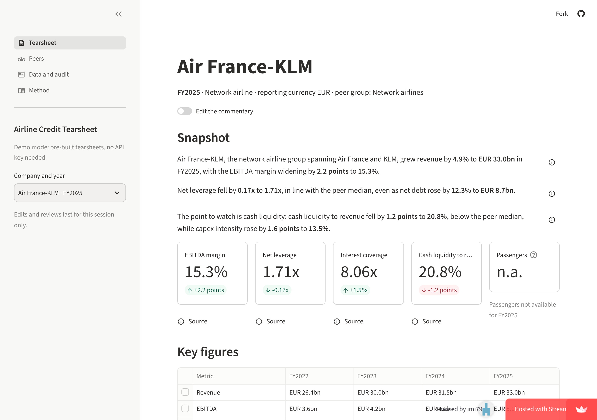

# Gate 3: the public link works in a fresh browser with no key

Checked on 2026-11-11 against **https://airlines-analyzer.streamlit.app** (Streamlit Community
Cloud, deployed by Imane from `main`, public repository), from a fresh browser: no cookies, not
signed in, no API key anywhere.

| Check | Result |
| --- | --- |
| The public page opens without signing in | yes: Air France-KLM FY2025 on screen 10.2 s after the request (Streamlit's page, then the app inside it) |
| The tearsheet, opened directly (Aena FY2025) | on screen in 3.3 s |
| A figure followed down its trail | Net leverage › Net debt, with its formula and inputs |
| PDF export and download | `aena_FY2025.pdf`, 2 pages, bundled font (Tearsheet Inter) throughout |
| Peers, Data and audit, Method pages | all open |
| The verifier demo ("Try the verifier") | the faulty example rejected: "Rejected: 2 problem(s)" |
| Errors on any page | none |

**Before it passed** (for the record): the first two tries showed Streamlit's "You do not have
access to this app or it does not exist", first because the repository was private (an app
from a private repository is private), then because no app existed under the account; Imane
made the repository public and deployed again.

**Imane's own check:** open the link in a private window on her phone.

**Sleep:** a free app sleeps after 12 hours without visitors; the first visitor then clicks
"Yes, get this app back up!" and waits about half a minute (see the demo script).
