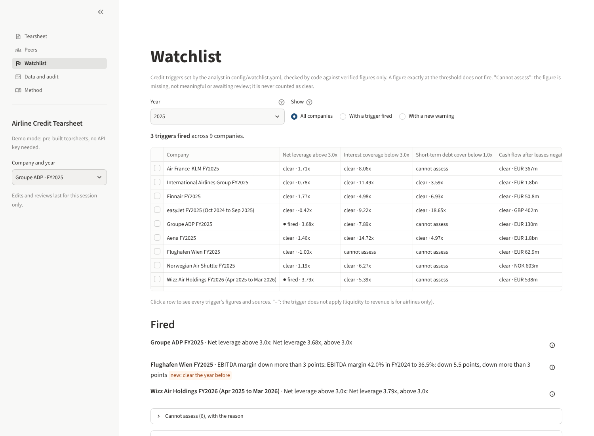
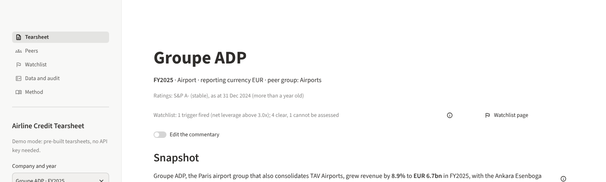
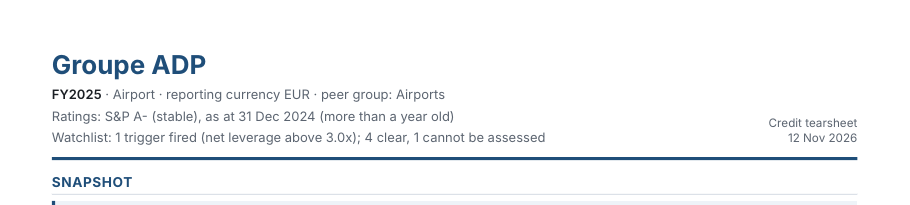

# M9 walkthrough: a watchlist of credit triggers

**What M9 built.** The first thing a credit analyst looks at each morning: *which of my names
crossed a trigger, and why?* You set the triggers, like covenants you write for yourself; the
tool checks every company and year against them, from verified figures only, and every flag
opens on the figures behind it, down to the filing. No new data, no AI tokens; the commentary is
not redrafted.

## What you will see

| Where | What is new |
| --- | --- |
| **Watchlist page** (new, in the left menu) | Companies down the side, your seven triggers across the top, for one year. Each cell: **fired**, **clear** or **cannot assess**, with the figure. Filters: "with a trigger fired", "with a new warning" (fired this year, not the year before). Below the table: each fired trigger in one sentence, with a source button; the "cannot assess" list with the reason for each |
| **Tearsheet**, under the ratings | One line: "Watchlist: 1 trigger fired (net leverage above 3.0x); 4 clear, 1 cannot be assessed", a source button, and a link to the page |
| **PDF**, under the ratings | The same line |
| **Method page** | A short paragraph on how the watchlist works |

## Your seven triggers

They live in `config/watchlist.yaml`, written the way you would read them, each with its reason,
your name and the date (2026-11-12). To change a threshold, change the number there: "3.0x"
becomes "3.5x", and the page and the PDFs follow, with no rebuild.

| Trigger | Kind | Applies to |
| --- | --- | --- |
| Net leverage above 3.0x | level | all |
| Interest coverage below 3.0x | level | all |
| Short-term debt cover below 1.0x | level | all |
| Cash flow after leases negative | level | all |
| Liquidity to revenue below 20% | level | airlines only |
| Net leverage up more than 0.5x | move on the year | all |
| EBITDA margin down more than 3 points | move on the year | all |

**Three rules, in covenant terms.**

1. **The threshold is strict**, as in a covenant test: "above 3.0x" breaches only above it.
   Exactly 3.0x is compliant.
2. **The test uses the exact figure, not the rounded one.** Aena FY2022's net leverage is
   3.0031x, printed "3.00x": it fires. The card says "stored value 3.0031x", so you are not
   left wondering why 3.00x breached 3.0x.
3. **What the tool cannot see, it does not pass.** If the figure is missing, not meaningful
   (for example leverage when EBITDA is negative, or a ratio to a very small debt) or still
   awaiting your review, the cell says **cannot assess**, with the reason. A watchlist that
   quietly passes what it cannot see is worse than none (your answer to question 4).

**One addition beyond the plan, for you to keep or remove: a floor for liquidity.**
Liquidity is cash plus the undrawn credit lines. The undrawn lines are often the missing piece
(not in the report, or awaiting your review). But if cash alone is already 20% of revenue or
more, liquidity is too: the credit lines can only add to it. In that case the trigger shows
**clear**, and its card says it was decided on cash alone. Think of it as a lender who sees
enough cash on deposit to pass the test without looking at the revolver. It can only clear the
trigger, never fire it, and is not used where liquidity itself is verified. It decides 7 of
the 12 airline tearsheets (Air France-KLM, easyJet FY2024, Norwegian, Wizz Air). It is one
line in the triggers file (`floor:`) if you would rather see "cannot assess" there.
(Decision 0023.)

## The findings: what fired

On the 18 tearsheets: **9 triggers fired, 97 clear, 14 cannot assess** (120 checks).

| Company and year | Trigger | Figure |
| --- | --- | --- |
| Groupe ADP FY2024 | Net leverage above 3.0x | 4.13x |
| Groupe ADP FY2025 | Net leverage above 3.0x | 3.68x (down from 4.13x, still above) |
| Wizz Air FY2025 (Apr 2024 to Mar 2025) | Net leverage above 3.0x | 4.28x |
| Wizz Air FY2026 (Apr 2025 to Mar 2026) | Net leverage above 3.0x | 3.79x |
| Air France-KLM FY2024 | Cash flow after leases negative | EUR −1.1bn |
| Air France-KLM FY2024 | Net leverage up more than 0.5x | 1.29x to 1.88x, up 0.59x |
| Finnair FY2024 | EBITDA margin down more than 3 points | 18.0% to 14.6%, down 3.4 points |
| Norwegian FY2024 | EBITDA margin down more than 3 points | 22.6% to 18.9%, down 3.7 points |
| Flughafen Wien FY2025 | EBITDA margin down more than 3 points | 42.0% to 36.5%, down 5.5 points (new this year) |

None of these is a surprise for a credit reader, which is what you want from a first set of
thresholds: ADP and Wizz Air carry the most leverage of their groups; Air France-KLM's 2024 cash
burn after leases and the margin drops at Finnair and Norwegian are in their commentary. Vienna's
margin drop is the one "new warning" of 2025; its leverage is net cash, so it is a profitability
signal, not a solvency one.

**Where the tool cannot tell (14).**

- **Short-term debt cover, 12 of 18**: the undrawn credit lines are not in the report for that
  year (9) or are awaiting your review (3: Air France-KLM FY2024 and FY2025, easyJet FY2024).
  Approving those in the Data and audit page lets the trigger use them. A floor like the
  liquidity one (cash alone against the debt due within a year) would decide most of the rest,
  but it needs a new ratio in the catalog: **your call** whether to add it.
- **Interest coverage at Flughafen Wien, 2**: its debt is very small, so the ratio is not
  meaningful (the same rule as the peer tables since M4).

**Your thresholds, after these results** (plan question 2 said you would adjust them). Two
observations to help: at 3.0x, net leverage flags the two names everyone would flag (ADP, Wizz
Air) and nothing else; interest coverage below 3.0x and short-term cover below 1.0x fire
nowhere in 2024-2025 (their lowest are Finnair FY2024 at 4.15x coverage, and IAG FY2025 at 3.59x cover
among the tearsheets that can be assessed), so they act as tail-risk alarms, not daily signals.

## How to try it

1. Open the app (`uv run tearsheet app`, or the public link once merged) and click
   **Watchlist** in the left menu. The year starts at the year of the tearsheet you were on.
2. Choose **With a new warning**: only Flughafen Wien FY2025 remains.
3. Click the ⓘ next to "Groupe ADP FY2025 · Net leverage above 3.0x": the card shows 3.68x
   against 3.0x, why the trigger matters, who set it and when; click "Net leverage" under
   "Built from" and follow it down to net debt and EBITDA, then to the filing.
4. Click a row of the table: every trigger for that company, each with its figures.
5. On the Tearsheet page, the line under the ratings has its own ⓘ and a "Watchlist page" link.
6. In demo mode, approve Air France-KLM's FY2025 undrawn lines on the Data and audit page: the
   liquidity trigger now uses liquidity itself instead of the cash floor. Nothing is saved.

## The checklist

| Item | Result | |
| --- | --- | --- |
| Every trigger evaluated for every company and year shown, from verified figures only; missing or unverified figures "cannot assess" with the reason | Every company and every year in the library (FY2021-FY2026), every trigger that applies: a result, and a reason for each cannot-assess; no fired or clear result rests on an unverified figure (`tests/test_watchlist.py`) | ✓ |
| Every fired trigger traces to the figure behind it on click | 18 of 18 tearsheets: each fired trigger's card leads down to filing facts, quotes or hand entries, all checkable; also part of the page's figures, so the existing source test and the export manifest cover them | ✓ |
| Unit tests for each trigger kind, the edges and "cannot assess" | Level above and below, cash flow below zero, moves up and down (in points), exactly at the threshold for each, missing, not meaningful, awaiting review, last year missing, the floor (clears, cannot decide, never overrides) | ✓ |
| The PDF still fits two pages for all 18 tearsheets | 18 of 18; the new line changed no text size (11 at 8.5 point, 7 at 8.0, as before M9). Excel recalculated 18 of 18 | ✓ |

## What I need from you

1. Read the Watchlist page and tell me if a fired trigger surprises you, or a threshold should
   move.
2. Keep or remove the liquidity floor; and say whether you want the same floor for short-term
   debt cover (a new ratio in the catalog).
3. Say go to merge into `main` (the public link follows `main`).
